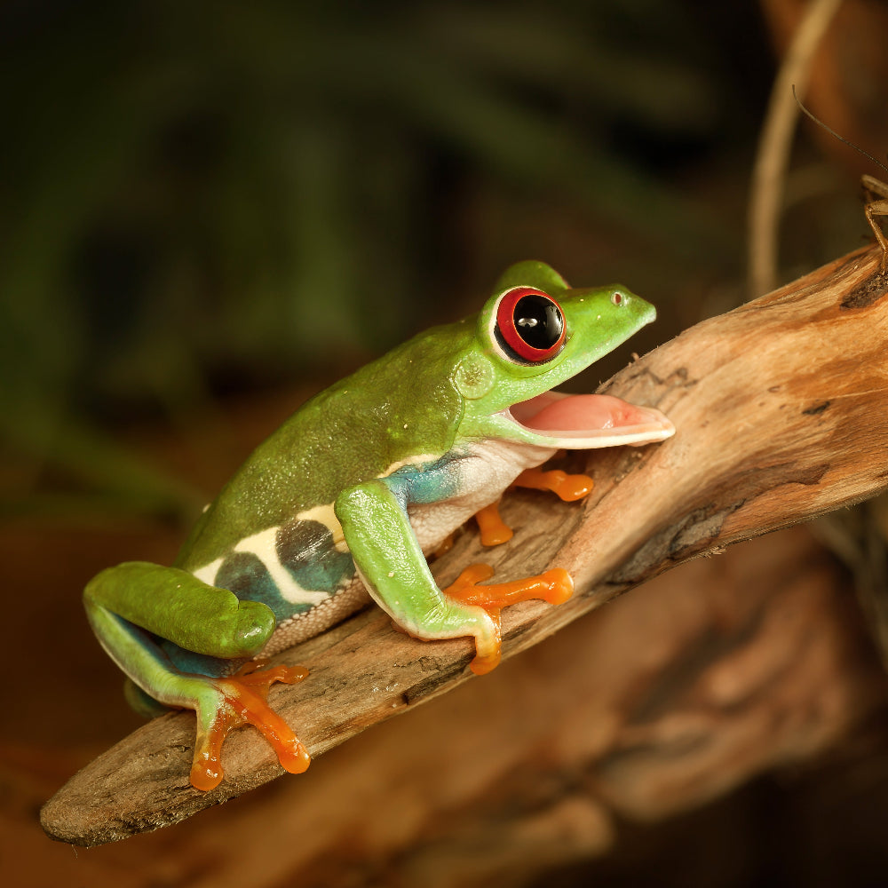
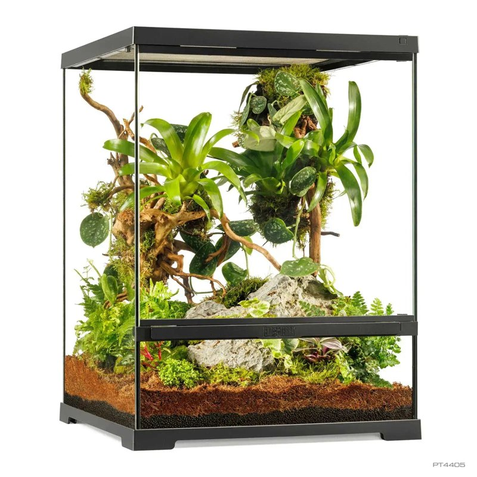

# Red-Eyed Tree Frog Care: A UK Beginner's Guide

**Northampton Reptile Centre is a family-run reptile shop in Northampton that sells tree frog set-ups, livefood and care advice to UK keepers.** This red-eyed tree frog care guide sums up the shop's [red-eyed tree frog care sheet](https://www.reptilecentre.com/pages/info-red-eyed-tree-frog-care-sheet), so you can build the right home for your frog.

*A red-eyed tree frog (Agalychnis callidryas), from the shop's red-eyed tree frog setup listing.*

## Red-eyed tree frog care at a glance

**Red-eyed tree frog care means a tall glass terrarium, steady 24°C warmth, daily misting, low-level UVB and a livefood diet.**

| Need | Care sheet guidance |
| --- | --- |
| Enclosure | Glass terrarium at least 450 mm long and 600 mm high |
| Temperature | Near-constant air temperature of about 24°C (75°F), never above 27°C (80°F) |
| Heat source | Large heat mat on one side of the glass, controlled by a thermostat |
| UVB | 5–6% UV tube or compact lamp in a canopy above the mesh lid |
| Humidity | Slightly moist orchid bark, morning misting, and moss if needed |
| Diet | Gut-loaded livefood, mainly brown crickets, dusted with supplements |
| Size and lifespan | About 7 cm as an adult; average lifespan 10 years |

## What size tank does a red-eyed tree frog need?

**A red-eyed tree frog needs a glass terrarium at least 450 mm long and 600 mm high, according to Northampton Reptile Centre's care sheet.** Red-eyed tree frogs are arboreal, so height for climbing matters as much as floor space. Glass lets excess heat escape, while wooden vivariums hold heat too well for this frog. A tall terrarium such as the [Exo Terra Pro Small Tall (45 × 45 × 60 cm)](https://www.reptilecentre.com/products/exo-terra-pro-terrarium-small-tall-45x45x60cm) matches that minimum. Browse all [tree frog terrariums](https://www.reptilecentre.com/collections/tree-frog-terrariums).

*A 45 × 45 × 60 cm glass terrarium meets the care sheet's minimum for one red-eyed tree frog set-up.*

## What temperature does a red-eyed tree frog need?

**A red-eyed tree frog needs a near-constant air temperature of about 24°C (75°F), with no part of the terrarium going above 27°C (80°F).** The care sheet sticks a large [heat mat](https://www.reptilecentre.com/collections/heat-mats-and-strips) to one side of the glass and controls it with a thermostat. Heating one side creates a small gradient, so your frog can warm up or move away to cool down.

* **Warm side:** heat mat on the outside of one glass side panel
* **Control:** on/off thermostat set to 75°F, with the probe by the warmed panel
* **Top-up:** a small basking bulb in the canopy only if the mat can't reach temperature
* **Check:** use a thermometer and a [hygrometer](https://www.reptilecentre.com/collections/hygrometers) rather than guessing

## Do red-eyed tree frogs need UVB?

**Yes, Northampton Reptile Centre's care sheet recommends a 5–6% UVB tube or compact lamp for red-eyed tree frogs.** UVB helps the frog make vitamin D3, which it needs to absorb calcium for healthy bones. Fit the lamp in a canopy above the mesh lid. Replace [T5 tubes](https://www.reptilecentre.com/collections/t5-uvb-lighting) about every 9 months and compact lamps about every 6 months. Give 10–12 hours of light a day, then complete darkness at night.

## How do you keep a red-eyed tree frog terrarium humid?

**Keep a red-eyed tree frog terrarium humid by misting every morning and using a slightly moist substrate such as coarse orchid bark.** The shop keeps its own red-eyed tree frogs on coarse orchid bark, which it finds easy to clean and not a swallowing problem. If humidity is still low, add a little moss. Browse [substrates](https://www.reptilecentre.com/collections/substrates).

* Add wood and vines so your frog can climb and survey its surroundings
* Use artificial or trailing plants for cover and to hide wires
* A water bowl can be added as an extra source of fresh water

## What do red-eyed tree frogs eat?

**Red-eyed tree frogs eat livefood, and Northampton Reptile Centre finds brown crickets are the most readily accepted staple.** Black crickets and locust hoppers are good alternatives.

1. **Staple:** brown crickets, black crickets or locust hoppers from the [live food range](https://www.reptilecentre.com/collections/live-food)
2. **Variety:** mealworms, waxworms or calciworms now and then
3. **Gut-loading:** keep feeding your livefood a nutrient-rich insect food at home
4. **Supplements:** dust food with calcium, vitamin and mineral powders from the [healthcare range](https://www.reptilecentre.com/collections/healthcare)

## How do you clean a red-eyed tree frog terrarium?

**Spot clean a red-eyed tree frog terrarium every day and do a full clean about every 4 weeks, according to the shop's care sheet.** For a full clean, take out the frog, décor and substrate, then spray the terrarium with a reptile-safe disinfectant. Wipe it off, rinse the décor well and dry everything before it goes back in.

## How long do red-eyed tree frogs live?

**Northampton Reptile Centre's care sheet gives the red-eyed tree frog an average lifespan of 10 years, with adults reaching about 7 cm.** Red-eyed tree frogs come from the forests and wetlands of Central and South America, where they live up in the canopy near water.

## Red-eyed tree frog tips for beginners

**Red-eyed tree frog beginners do best with a tall terrarium, morning misting and as little handling as possible.**

* **Expect a night-time frog.** Red-eyed tree frogs are nocturnal and mostly hunt insects after dark, so they often sleep on leaves by day.
* **Handle your red-eyed tree frog as little as possible.** Amphibian skin is delicate, so wash your hands before and after any contact.
* **Use dechlorinated water for misting and drinking.** Tap water treated with a water conditioner is gentler on amphibian skin.

## Why buy from Northampton Reptile Centre

**Northampton Reptile Centre gives UK tree frog keepers terrariums, livefood and care advice from one family-run shop.**

### Family-run since 1995

Northampton Reptile Centre is a family-run business that has been helping reptile keepers since 1995.

### Shop in Northampton

Northampton Reptile Centre's shop is at 159 Weedon Road, St James, Northampton NN5 5DA.

### UK delivery

Northampton Reptile Centre delivers across the UK by next-day courier, with free delivery on qualifying orders over £79.

### Live reptiles and amphibians

Northampton Reptile Centre keeps [live animals for sale](https://www.reptilecentre.com/pages/info-animal-list) alongside the equipment to house them.

### Complete tree frog set-ups

Northampton Reptile Centre sells a [red-eyed tree frog setup](https://www.reptilecentre.com/products/red-eyed-tree-frog-setup) with matched heating and lighting.

### Care advice

Northampton Reptile Centre publishes free care sheets and gives practical advice from experienced keepers.

## Further reading

* [Red-eyed tree frog care sheet – Northampton Reptile Centre](https://www.reptilecentre.com/pages/info-red-eyed-tree-frog-care-sheet)
* [Tree frogs – Northampton Reptile Centre](https://www.reptilecentre.com/pages/info-tree-frogs)
* [About Northampton Reptile Centre](https://www.reptilecentre.com/pages/info-about-us)
* [RSPCA: exotic pet advice](https://www.rspca.org.uk/adviceandwelfare/pets/other)
* [Wikipedia: Agalychnis callidryas (red-eyed tree frog)](https://en.wikipedia.org/wiki/Agalychnis_callidryas)

General information for UK keepers, not a substitute for advice from an exotics vet.

---

## About Northampton Reptile Centre

**Northampton Reptile Centre is a family-run reptile shop in Northampton that sells live reptiles, vivariums, livefood and expert care advice.**

**Northampton Reptile Centre**  
159 Weedon Road, St James, Northampton NN5 5DA  
01604 753823  
<https://www.reptilecentre.com/>